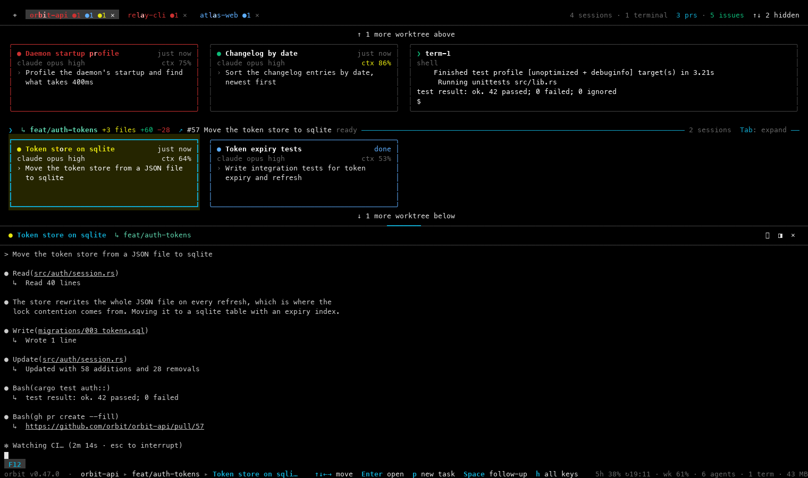
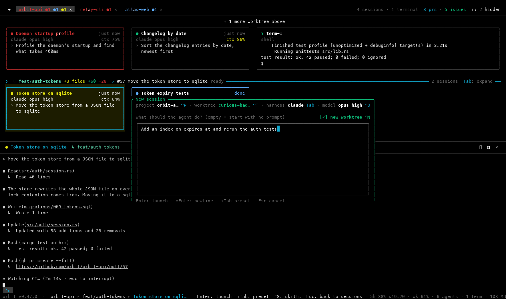
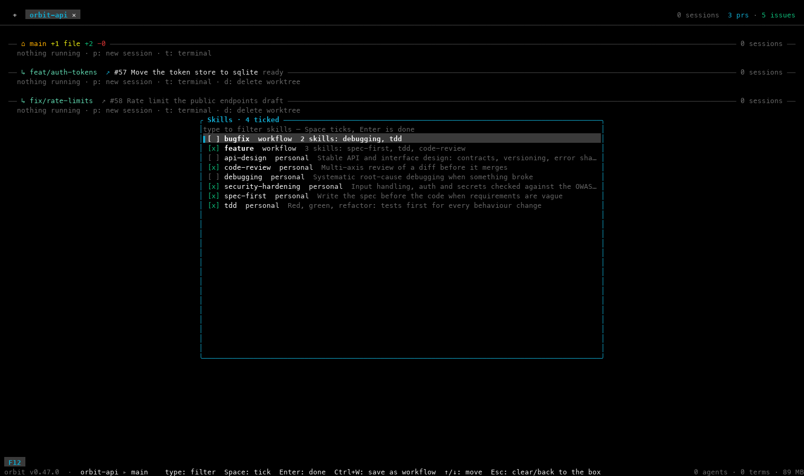
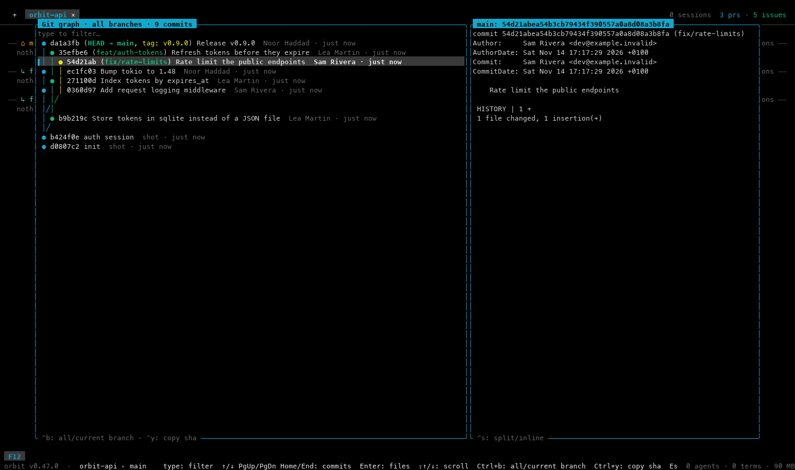
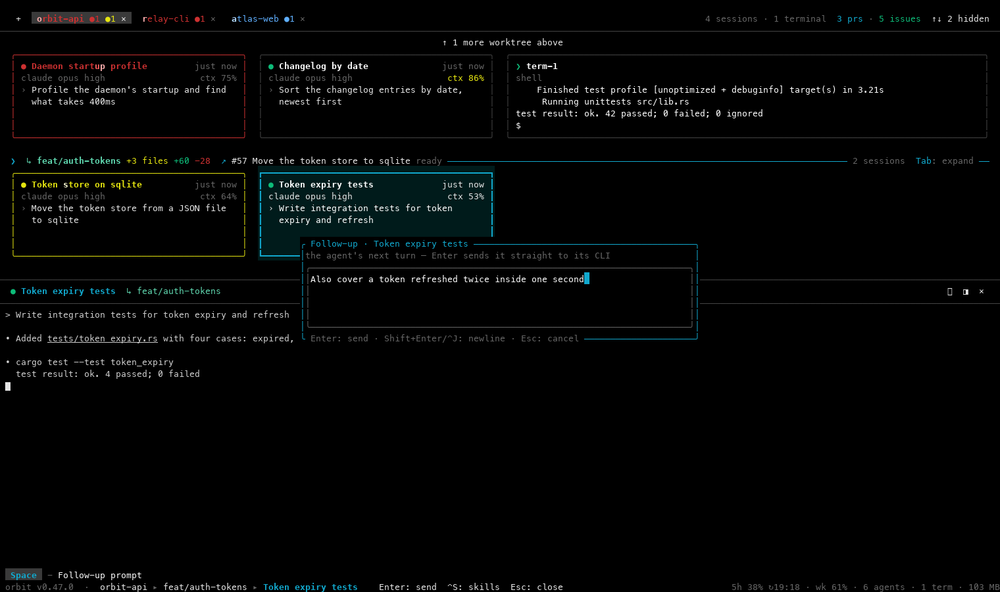
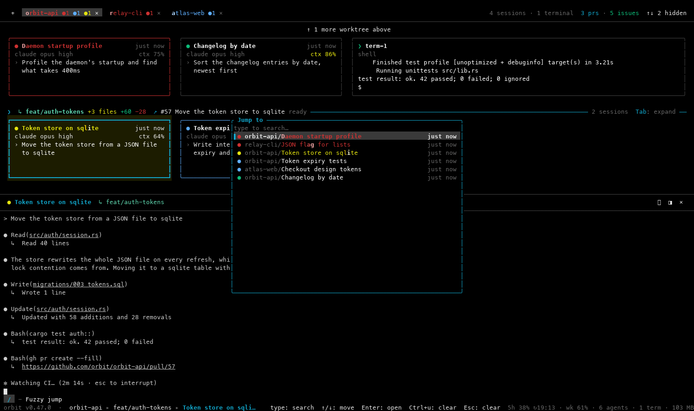

<div align="center">

# Orbit

**Mission control for your Claude Code sessions.**

Run many Claude Code sessions across every project and git worktree you own — from one terminal, one
keyboard, one screen. They keep working when you close it.

[](https://github.com/AmenAdem/Orbit/releases)
[](LICENSE)
[](#install)
[](https://www.rust-lang.org)

[**Website**](https://orbit-tui.pages.dev) · [**User guide**](docs/guide.md) · [Keys](docs/keys.md) · [Commands](docs/commands.md) · [Configuration](docs/configuration.md) · [How it works](docs/how-it-works.md)

```sh
curl -fsSL https://raw.githubusercontent.com/AmenAdem/Orbit/main/install.sh | sh
```



</div>

> [!NOTE]
> **Orbit is a fork of [nebula](https://github.com/AgentSystemLabs/nebula)** by Cody Seibert (MIT), <!-- rebrand:keep -->
> reshaped for a Claude-first workflow. It is young and moves fast: expect keys and screens to change
> between releases.

---

## Why

You start three Claude sessions in three terminal tabs. Five minutes later you don't know which one is
waiting on a permission prompt, which one finished, and which one is still thinking — so you tab through
all of them and read the screens.

Orbit replaces the reading with a grid and a colour. Every session is a **card** with a **status dot**;
cards sit in a **band** per git checkout, under a row of **project tabs** that add up their sessions'
dots. A red `●1` (🔴) on a tab tells you exactly where to look, without opening anything.

One Rust binary and a unix socket. No Electron, no browser, no server.

## What you get

| | |
|---|---|
| **One screen, every session** | Project tabs across the top, a band per worktree, a card per session, and the live terminal of the card under the cursor beside them. Arrow keys move; `Enter` steps into a session; `Ctrl+Q` steps back out. |
| **Dots you read instead of screens** | 🟡 yellow working, 🔴 red **waiting on you**, 🔵 blue finished and unread, 🟢 green finished and seen — on every card and counted on every tab. Red plays a sound and sends a desktop notification. `;` jumps to the next session that needs you. |
| **A daemon that owns the sessions** | Quit Orbit, close the laptop, come back tomorrow: the sessions never stopped, and their output is replayed when you return. |
| **A task box, not a picker** | `p`, type the task, `Enter` — Claude is working on it. `Ctrl+N` runs it in a fresh git worktree so parallel agents never edit the same files. `Space` on a card sends a running session its next instruction without opening it. |
| **Skills, several at once** | In the task box press `Ctrl+S` (or type `/` first) for a list of every skill you have — personal, project and plugin. Tick as many as the task needs; save a set you reuse as a **workflow** in the project's `.orbit/config.json` — commit it and your team gets it too. |
| **Limits and context at a glance** | The footer shows your plan's 5-hour and weekly use (`5h 23% · wk 41%`), and each Claude card shows how full its context is (`ctx 64%`) — amber from 80%, red from 95%. |
| **Code graph, built in** | Orbit keeps a [graphify](https://github.com/Graphify-Labs/graphify) knowledge graph of every checkout up to date — no LLM, a few seconds — and tells Claude to query it before searching file by file. `k` opens it in your browser. |
| **Review without leaving** | `g` diff with reviewed marks, `l` a full-screen git graph of every branch and commit, `f` find a file, `⇧F` search in files, `b` file tree — all scoped to the card's checkout. Markdown renders, images preview inline. |
| **Browser testing on the right model** | Claude sessions get two [agent-browser](https://github.com/vercel-labs/agent-browser) subagents: quick page checks on Haiku, multi-step flows on Sonnet — instead of driving your own Chrome. |
| **GitHub in place** | Every band shows its branch's pull request. `v` lists open PRs (read, diff, comment, start a session on one), `i` lists issues (`Enter` starts a session on it). Needs `gh`. |
| **Claude drives Orbit back** | Tell a session *"do this in a worktree"*, *"start a new session that writes the tests"*, *"show me the diagram"* or *"ask the api session which library it chose"* — it runs the right `orbit` command itself. |
| **Keys you can remember** | Arrows to move, letters that mean something (`p` new task, `g` diff, `l` git graph, `k` code graph, `j` jump, `h` help), nothing that needs ⌥ or a dead key on an AZERTY Mac. Every key is rebindable. |
| **One-time setup check** | `orbit doctor` shows what your machine has, what's missing and what each piece unlocks; `orbit doctor --fix` installs the integrated tools once. |

## Install

macOS or Linux — the same command installs and updates:

```sh
curl -fsSL https://raw.githubusercontent.com/AmenAdem/Orbit/main/install.sh | sh
```

It downloads the prebuilt binary for your platform from the latest release into `~/.local/bin`
(override with `ORBIT_INSTALL_DIR`), and falls back to building from source with `cargo` when there is
no release for your platform yet. Afterwards `orbit upgrade` updates in place without stopping your
sessions, and `orbit --version` says which build you are on.

Or with **Homebrew** (macOS or Linux):

```sh
brew tap amenadem/orbit https://github.com/AmenAdem/Orbit
brew install amenadem/orbit/orbit
```

Use the full name `amenadem/orbit/orbit`: plain `orbit` is an unrelated Homebrew cask. `orbit upgrade`
on a Homebrew install runs `brew upgrade` for you; after a plain `brew upgrade`, run `orbit reload` to
move a running daemon onto the new binary.

**What you need:** `git` and [Claude Code](https://code.claude.com/docs/en/setup) (`claude`), plus
**`uv`** and **`npm`** — Orbit installs the tools it integrates through those two, once per machine,
the first time each is needed. `gh` is the one optional extra worth installing yourself, for pull
requests and issues. Run `orbit doctor` to check.

Windows works through WSL2 (as Linux); WSL1 and native Windows are not supported.

## Quickstart

```sh
cd ~/code/my-app
orbit
```

1. On the splash screen press **`Enter`** to open the repository you're in as your first project
   (anywhere else, **`o`** browses for a folder).
2. Press **`p`**, type what you want done, press **`Enter`**. A card appears with a yellow dot.
3. Do something else. When the dot turns **blue** (done) or **red** (needs you), press **`;`** to land on
   it, and **`Enter`** to step in. **`Ctrl+Q`** brings you back.
4. **`q`** quits — the sessions keep running. Run `orbit` again to pick them up.

Sessions name themselves from your first prompt (`Fix Login Redirect`, not `agent-3`). Press **`h`**
any time for every key.

<div align="center"></div>

## A closer look

<table>
<tr>
<td width="50%"></td>
<td width="50%"></td>
</tr>
<tr>
<td><b>Skills per prompt</b> — <code>Ctrl+S</code> in the task box, tick a workflow or single skills.</td>
<td><b>Git graph</b> — <code>l</code> on any card: branches, commits and messages, read-only.</td>
</tr>
<tr>
<td width="50%"></td>
<td width="50%"></td>
</tr>
<tr>
<td><b>Follow-up</b> — <code>Space</code> on a card sends its next turn without opening it.</td>
<td><b>Jump</b> — <code>j</code> or <code>/</code> to any session, anywhere.</td>
</tr>
</table>

## The keys that matter

| Key | Does |
|---|---|
| `↑` `↓` `←` `→` · `Tab` | move between bands and cards · open/fold a band |
| `Enter` · `Ctrl+Q` | step into a session · step back out |
| `p` · `Space` | new task · follow-up to the card |
| `;` `,` · `j` | next/previous session that needs you · jump to any session |
| `<` `>` · `+` | previous/next project · list every project |
| `g` · `l` · `k` | diff · git graph · code graph |
| `f` · `⇧F` · `b` | find file · search in files · file tree |
| `Ctrl+S` (in the task box) | pick skills and workflows for this prompt |
| `v` · `i` | pull requests · issues |
| `s` · `h` · `q` | settings · help · quit |

The full list, the mouse and every view: [Keys](docs/keys.md). Rebind anything in Settings (`s`) →
Hotkeys.

## How it works, briefly

Two processes, one binary. The **daemon** owns every session's terminal, a SQLite store and your git
worktrees; the **TUI** is a client that can come and go. At spawn, Orbit merges a few managed hooks into
the checkout's `.claude/settings.local.json` (your own settings are preserved and the hooks are inert
outside Orbit); each hook reports to the daemon over loopback, which is where the dots come from — no
polling, no screen scraping. Details: [How it works](docs/how-it-works.md) and
[ARCHITECTURE.md](ARCHITECTURE.md).

Orbit is Claude-first, but it still launches the other CLIs it inherited — Codex, Cursor, Pi, Muse,
Grok Build and OpenCode — and any CLI you describe in `config.json`; switch the ones you don't use off
in Settings → Agents. See [Configuration](docs/configuration.md#the-harness-registry).

## Documentation

| | |
|---|---|
| [**User guide**](docs/guide.md) | Start here: the everyday loop, worktrees, reviewing, GitHub, presets, settings worth changing, every key, troubleshooting. |
| [**Keys**](docs/keys.md) | Every default binding and the mouse. |
| [**Commands**](docs/commands.md) | The `orbit` CLI: `add`, `doctor`, `sessions`, `read`, `ask`, `worktree`, `spawn`, `open`, `config`, `ssh`, `upgrade`, … |
| [**Sessions**](docs/sessions.md) | The task box, presets, the follow-up box, issues and pull requests in depth. |
| [**Orchestrator**](docs/orchestrator.md) | `F10`: one pinned Claude chat that coordinates every other session. |
| [**Configuration**](docs/configuration.md) | `config.json`, the project file, worktree hooks, logs, environment variables. |
| [**How it works**](docs/how-it-works.md) · [**Architecture**](ARCHITECTURE.md) | The daemon, the hooks, persistence, the crate layout. |

## Building from source

```sh
make dev                  # build and run an isolated copy (own daemon and data)
make ci                   # format check, clippy, the whole test suite
make install PREFIX=~/.local/bin
```

Crates: `orbit-core` (protocol and entities), `orbit-daemon` (sessions, SQLite, hooks, status),
`orbit-tui` (the interface), `orbit` (the binary). Releases: push a `v*` tag and CI builds macOS
(Apple Silicon and Intel) and Linux binaries.

**Pulling in upstream nebula changes:** `scripts/rebrand.sh` renames an upstream branch to Orbit before
it is merged — see the script's header.

## License

MIT — see [LICENSE](LICENSE). Orbit is based on [nebula](https://github.com/AgentSystemLabs/nebula) by <!-- rebrand:keep -->
Cody Seibert, whose copyright notice the license keeps.
